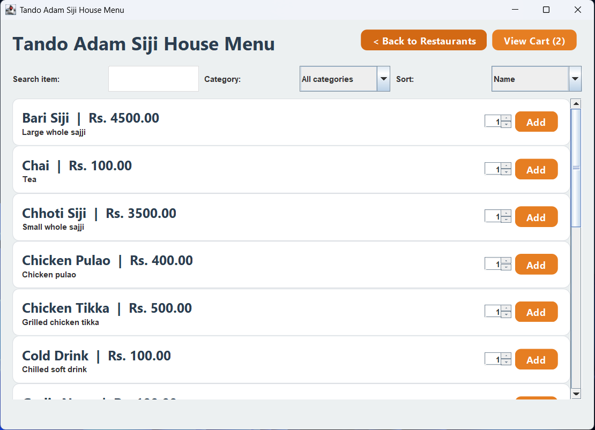

<div align="center">

# 🍽️ Food Ordering System

### A desktop restaurant ordering and management application built with Java Swing and MySQL

<p>
  
  
  
</p>

</div>

## ✨ Overview

Food Ordering System is a Java desktop application for browsing restaurants and menus, managing a shopping cart, and placing orders through a MySQL-backed database.

It also demonstrates secure authentication, transaction-safe order processing, and reusable custom Swing components.

## 🚀 Features

| Area | Highlights |
| --- | --- |
| 🔐 Authentication | Registration and login protected with salted `PBKDF2WithHmacSHA256` password hashing |
| 🍔 Restaurant & menus | Browse restaurants, cuisines, categories, menu items, and ratings |
| 🛒 Cart & orders | Add multiple items, update quantities, and place orders atomically |
| 🖥️ Desktop UI | Custom rounded panels, buttons, themes, and dedicated Swing screens |
| 🛡️ Database safety | Parameterized queries and transaction handling with `commit` / `rollback` |

## 🧰 Prerequisites

- **JDK 17 or newer**
- **MySQL Server 8.0 or newer**
- **MySQL Connector/J**, included in `lib/`

## ⚙️ Setup

### 1. Prepare the database

> [!CAUTION]
> `database/schema.sql` contains `DROP TABLE IF EXISTS` statements. Back up existing data before running it.

Start MySQL on port `3306`, then execute the schema and seed scripts:

```sql
SOURCE database/schema.sql;
SOURCE database/seed_data.sql;
```

For local development, create a dedicated database user instead of using `root`:

```sql
CREATE USER 'food_app_user'@'localhost' IDENTIFIED BY 'StrongPasswordHere123!';
GRANT SELECT, INSERT, UPDATE, DELETE ON food_ordering_system.* TO 'food_app_user'@'localhost';
FLUSH PRIVILEGES;
```

### 2. Configure the database connection

Create a local configuration file from the included template:

```bash
# Linux / macOS
cp db.properties.example db.properties

# Windows PowerShell
Copy-Item db.properties.example db.properties
```

Then update `db.properties` with your local credentials:

```properties
db.url=jdbc:mysql://localhost:3306/food_ordering_system
db.user=food_app_user
db.password=StrongPasswordHere123!
```

> 🔒 `db.properties` is ignored by Git. Never commit real database credentials.

## ▶️ Build and run

From the project root:

### Windows PowerShell

```powershell
New-Item -ItemType Directory -Force out
javac -cp "lib/*" -d out (Get-ChildItem -Recurse -Filter *.java src | Select-Object -ExpandProperty FullName)
java -cp "out;lib/*" Main
```

### Linux / macOS

```bash
mkdir -p out
javac -cp "lib/*" -d out $(find src -name "*.java")
java -cp "out:lib/*" Main
```

## 📸 Screenshots

Screenshots would make the project easier to understand at a glance. The most useful captures would be:

1. Login or registration screen
2. Restaurant/menu browsing screen
3. Cart and checkout screen
4. Order receipt or confirmation screen

Add them to a folder such as `docs/screenshots/`, then embed them like this:

```md

```

## 🗂️ Project structure

```text
FoodOrderingSystem/
├── database/              # Schema, seed data, queries, and ERD model
├── lib/                   # Third-party runtime libraries
├── src/
│   ├── dao/               # Data access objects
│   ├── database/          # Database connection provider
│   ├── gui/               # Swing application windows
│   ├── model/             # Domain entities
│   ├── ui/                # Reusable UI components and styling
│   └── util/              # Session, cart, and window utilities
├── db.properties.example  # Safe database configuration template
└── README.md              # Project documentation
```

## 🔐 Security notes

- Database credentials are kept in the ignored local `db.properties` file.
- Passwords are salted with 16 random bytes and hashed with `PBKDF2WithHmacSHA256` using 120,000 iterations.
- User input is handled with `PreparedStatement` to reduce SQL injection risk.

